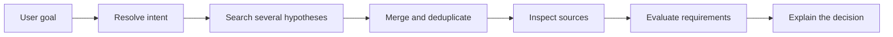
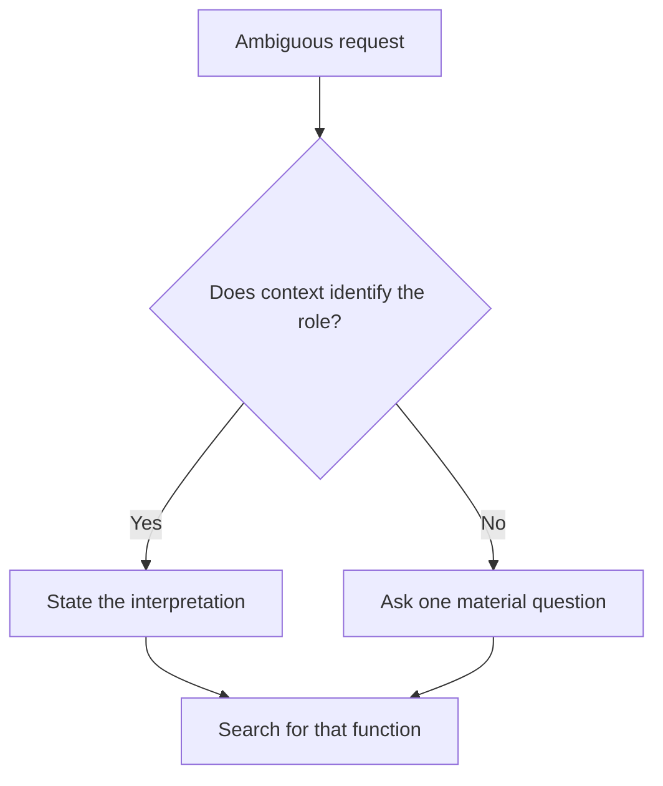
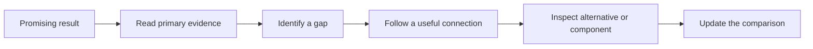
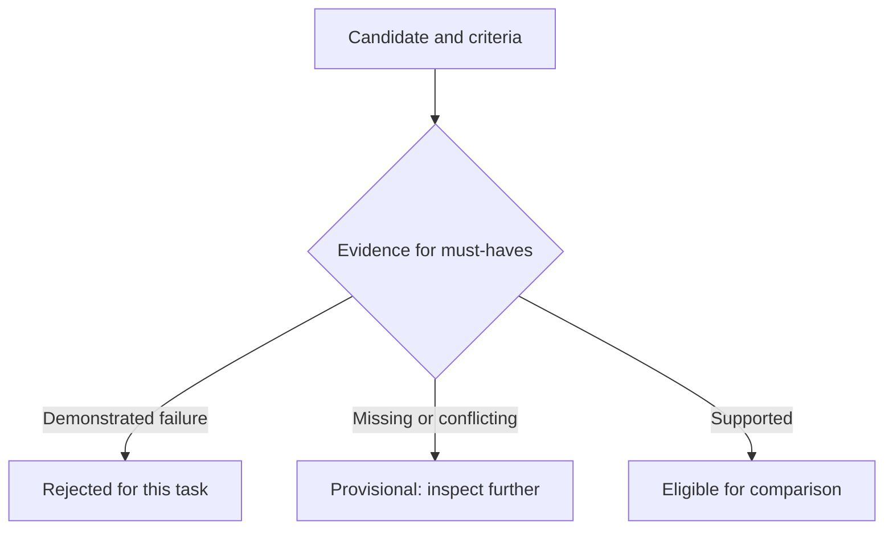
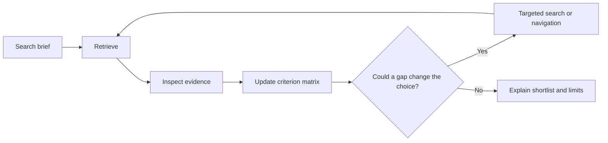
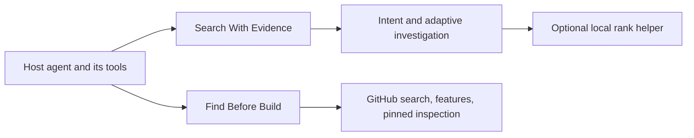

# How an agent can search better

**A study guide to search intent, repository navigation, evidence, and ranking**  
Research and implementation snapshot: **23 October 2026**.

This guide explains the existing work studied, the useful algorithms behind it, and the design implemented in this project. It is written to teach the ideas rather than replay every search. The HTML edition renders the diagrams and supports printing without an internet connection.

The concrete output is a portable **Search With Evidence** skill, plus a specialized **Find Before Build** repository skill. They guide an existing agent and its tools. They are not a new web index, a trained ranking model, or evidence that we outperform Google, Brave, or another research agent.

## 1. Start with three different problems

People often call all of these “search,” but they require different decisions:

| Problem | What it asks | Typical failure |
| --- | --- | --- |
| Understand intent | What result would actually help this person? | Search the wrong meaning of an example or entity. |
| Retrieve candidates | Where could relevant results be found? | One vocabulary or one index misses useful alternatives. |
| Evaluate results | Which candidates satisfy the goal, and why? | Popularity, attractive descriptions, or engine position replace evidence. |

A good retriever can return many relevant pages while still giving a poor recommendation. A good evaluator cannot select a page it never encountered. Better agent search therefore needs both breadth and careful inspection.



The agent's role is to control this process. The search engine supplies observations; it does not know every hidden requirement in the user's mind.

### What Google teaches us—and what it does not

Google publicly describes several systems that connect concepts with queries and content, and its AI Mode describes issuing related searches across subtopics. Those are useful architectural examples, not a public recipe for reproducing Google's complete ranking system. Our design borrows the general separation of interpretation, retrieval, and synthesis; it does not reproduce Google's index, models, training data, or infrastructure. [Google ranking systems](https://developers.google.com/search/docs/appearance/ranking-systems-guide), [query fan-out](https://blog.google/products-and-platforms/products/search/ai-mode-search/).

## 2. Intent: search the function behind the words

Consider “find platforms like GitHub.” Several interpretations are reasonable:

| Intended meaning | Useful search direction | Wrong-but-plausible answer |
| --- | --- | --- |
| Somewhere to host source code | Git hosting, permissions, collaboration, self-hosting | A list of interesting GitHub repositories. |
| Somewhere to discover projects | Code discovery, catalogs, topic exploration | Enterprise Git hosting pricing. |
| A tool for team collaboration | Code review, issues, CI integration | Any website containing the word “GitHub.” |

The agent should use the surrounding context. “Where people save their repositories” points toward hosting. If context does not distinguish materially different goals, one focused clarification is useful. Routine details can use stated assumptions rather than a questionnaire.



### The search brief

Before a difficult investigation, keep a compact brief containing the goal, result type, must-haves, preferences, exclusions, time/location constraints, and unresolved ambiguity. A course request might require beginner suitability and practical exercises, with a certificate merely preferred. Treating the certificate as mandatory would silently change the task.

This is also a defense against **intent drift**: the investigation starts with one need but gradually follows interesting adjacent topics. Every query expansion should still connect to the original brief.

An actual implementation issue illustrates the danger. The repository scorer initially inferred the Go programming language from any occurrence of “go.” “Go through repositories” therefore risked becoming a runtime constraint. The scorer now requires explicit language context for that ambiguous word, and a regression test covers the distinction. A small lexical inference can otherwise distort the whole ranking.

## 3. Existing skills: what we studied

We inspected public instructions and selected source files. We did **not** run paid research services or benchmark these packages against one another. Their limitations below are source-backed scope/tradeoff observations or explicitly marked inferences, not fabricated runtime defects.

The inspected revisions are recorded in `reports/search-skill-sources.json`. Pinned links let a reader revisit the same material even if the upstream projects change.

### Tavily's skill and references

The [Tavily skill](https://github.com/tavily-ai/skills/blob/778122e5f9c680f541eeceda5a5b36405eb7980c/skills/tavily-best-practices/SKILL.md) explains how to choose among search, extraction, mapping, crawling, and research. Its [search reference](https://github.com/tavily-ai/skills/blob/778122e5f9c680f541eeceda5a5b36405eb7980c/skills/tavily-best-practices/references/search.md) discusses query decomposition, filtering, and concurrent requests. The [research reference](https://github.com/tavily-ai/skills/blob/778122e5f9c680f541eeceda5a5b36405eb7980c/skills/tavily-best-practices/references/research.md) emphasizes a clear objective and distinguishes output modes.

**Useful lesson:** finding a URL, reading a URL, discovering a site's structure, and synthesizing research are different operations. Choosing the right operation is more effective than making every request a broad crawl.

**Scope limitation for our goal:** these are primarily instructions for a particular provider and its integration. Inference: a person wanting a general search method across existing tools still needs a separate policy for intent resolution, criterion judgments, and final comparison. This is not evidence that Tavily's underlying service lacks those capabilities.

### Parallel's web-search skill

The [inspected Parallel skill](https://github.com/parallel-web/parallel-agent-skills/blob/6c873020213d981984aa8e897cd55e5413d1322f/skills/parallel-web-search/SKILL.md) combines a natural-language objective with optional keyword queries. It preserves results in JSON, distinguishes truncated console output from the saved file, and instructs the agent to check errors and warnings before synthesizing citations.

**Useful lesson:** a failed command and an old output file must not masquerade as a new successful search. Evidence handling matters as much as query wording.

**Scope limitation:** the studied file is a CLI-backed lookup workflow with an explicit provider dependency. Inference: it is not by itself a provider-independent comparative search curriculum. This conclusion concerns that file, not every feature in Parallel's products.

### last30days

[last30days](https://github.com/mvanhorn/last30days-skill/blob/7fac0fc31ba5212b5ddaa29252d9f7148cec8423/skills/last30days/SKILL.md) is a substantial installable research skill focused on recent discussion across multiple sources. It is more than a short search prompt. We read its planner, fusion, and reranking code.

The [planner](https://github.com/mvanhorn/last30days-skill/blob/7fac0fc31ba5212b5ddaa29252d9f7148cec8423/skills/last30days/scripts/lib/planner.py) contains intent and source-routing logic. The [fusion implementation](https://github.com/mvanhorn/last30days-skill/blob/7fac0fc31ba5212b5ddaa29252d9f7148cec8423/skills/last30days/scripts/lib/fusion.py) combines ranked streams, handles duplicate identities, preserves enrichment, and includes diversity/reservation rules. The [reranker](https://github.com/mvanhorn/last30days-skill/blob/7fac0fc31ba5212b5ddaa29252d9f7148cec8423/skills/last30days/scripts/lib/rerank.py) supports model judgments and local fallbacks, along with entity-grounding and engagement-related logic.

**Useful lesson:** retrieval, deduplication, pooling, and reranking deserve separate stages. Real systems need careful identity and fallback handling, not just a clever ranking formula.

**Scope tradeoff:** a workflow centered on recent discourse and engagement is useful for recent-discussion questions. Inference: those objectives should not automatically decide the best foundational paper, beginner course, or reusable library. We therefore make criteria and freshness requirements explicit. This is not a claim that last30days is simplistic or that it cannot support other tasks.

### What is genuinely different in our design?

The algorithms are established. Our engineering emphasis is a portable method that works with the host's tools, checks the intended meaning, separates discovery order from recommendation eligibility, and records criterion-level uncertainty. Whether that combination improves real searches remains a testable question.

## 4. Retrieval: widen coverage without losing the task

### Query decomposition

Split a complex need into independently searchable parts. For a PDF merger with bookmarks, the whole product is one lane; PDF manipulation and bookmark preservation are capability lanes. A complete application and a specialist library can both be useful candidates.

Do not force one repository to implement every requirement. Conversely, do not combine several frameworks just because each matches a keyword: the interfaces and integration cost still matter.

### Query expansion

Expansion tries synonyms, functional descriptions, and related terminology. The [IR textbook's relevance-feedback discussion](https://nlp.stanford.edu/IR-book/html/htmledition/relevance-feedback-and-pseudo-relevance-feedback-1.html) explains using judged material to refine retrieval. [Query2doc](https://aclanthology.org/2023.emnlp-main.585/) studies LLM-generated pseudo-documents as query expansion.

Our adaptation is conservative: generated vocabulary is a **search hypothesis**, not a fact. Useful terminology found in inspected sources is preferable to invented specificity. Expansion should improve the chance of finding relevant material without silently redefining the question.

### Several kinds of navigation

Search results are entry points, not the entire information space:



Useful connections include repository upstreams and dependencies, papers' references and later citations, course prerequisites and sample assignments, and database records linked by observed identifiers. The connection needs a reason: “could this answer the missing bookmark requirement?” is useful; opening every outgoing link is not.

An awesome list can be an excellent map while being a poor implementation choice. A review article can expose terminology while the original paper owns an experimental claim. A course marketplace can reveal options while the official syllabus owns prerequisite and access facts.

### GitHub-specific query behavior

GitHub's default repository search scope includes name, description, and topics; README search requires `in:readme`. Best-match ordering is available without sorting by stars. The improved helper records the executed query and adds `archived:false` unless the caller supplies an archived qualifier. It preserves successful query results when another query fails. [GitHub repository qualifiers](https://docs.github.com/en/search-github/searching-on-github/searching-for-repositories), [REST search](https://docs.github.com/en/rest/search/search#search-repositories).

These filters help retrieval. They cannot prove a library's behavior, license compatibility, or suitability for a specific architecture.

## 5. Lexical ranking: BM25 and term rarity

Lexical methods compare words. They are useful, reproducible, and imperfect. A document containing “merging” may concern the same action as “merge,” while a page repeating every task keyword may still be irrelevant.

The repository helper uses modest morphological normalization and corpus-relative term rarity for coverage features. Metadata matches count more than incidental README mentions. This is an inspectable heuristic, not a semantic model.

BM25 addresses two problems with raw word counts: repeated occurrences have diminishing benefit, and document length should affect the score. A conventional form is:

```text
BM25(document, query) = sum over query terms:
  IDF(term) * tf(term, document) * (k1 + 1)
  ------------------------------------------------------
  tf(term, document) + k1 * (1 - b + b * length / avg_length)
```

`tf` is term frequency; `IDF` measures how uncommon a term is in the compared collection. `k1` controls saturation; `b` controls length normalization. The repository helper uses `k1 = 1.2` and `b = 0.75`, exposing BM25 as a tie-breaker rather than treating it as proof of task fit. [Stanford's probabilistic IR overview](https://nlp.stanford.edu/IR-book/html/htmledition/probabilistic-information-retrieval-1.html).

**Important limit:** corpus-relative scores change when the candidate pool changes. A score from a course search is not directly comparable with a repository score. No score here is a calibrated probability of success.

## 6. Rank fusion: combine lists without comparing engine scores

Different engines may return scores with unrelated scales. Adding a provider's “0.9” to another provider's “75” is usually meaningless. Reciprocal Rank Fusion uses positions instead:

```text
RRF(candidate) = sum across ranked lists of 1 / (60 + rank)
```

Suppose candidate A ranks first in one list and second in another. Its ordinary RRF contribution is `1/61 + 1/62`, approximately `0.03252`. Candidate B appears only first in one list, contributing approximately `0.01639`. RRF rewards repeated retrieval across lists without requiring their raw scores to be calibrated. The original study evaluates fusion on particular retrieval collections; its results do not establish gains for our agent. [Cormack, Clarke, and Buettcher, 2009](https://plg.uwaterloo.ca/~gvcormac/cormacksigir09-rrf.pdf).

### Our adaptation: cap similar query families

Ten near-identical rewrites can retrieve the same weak result ten times. That is repetition, not ten independent confirmations. The general helper groups related searches into query families and keeps only the candidate's strongest contribution within each family. A repeated identical provider/query adds observations without buying another fusion vote.

This cap is a design choice we implemented and tested for its intended invariant. The cited RRF paper does not prove our modification is better. Family assignments also require judgment: falsely labeling equivalent queries as unrelated defeats the protection.

### Discovery agreement is not factual agreement

Several engines finding one page tells us that page is discoverable. It does not independently confirm the page's claims. Syndicated articles, mirrors, repeated references to the same study, and several discussions of one release need provenance-aware handling.

The helper normalizes obvious tracking variants while preserving meaningful URL parameters and path case. It does not automatically assume similar titles, two paper versions, or two course IDs are identical.

## 7. Diversification: inspect something informative next

An initial result pool may contain many near-duplicates. Reading all of them can crowd out an unfamiliar but useful alternative. Maximal Marginal Relevance balances relevance and redundancy:

```text
inspection_priority = lambda * relevance
                      - (1 - lambda) * similarity_to_selected
```

For an illustrative `lambda = 0.75`, candidate B has relevance `0.98` but similarity `0.95` to an already selected page: priority `0.4975`. Candidate C has relevance `0.90` and similarity `0.10`: priority `0.65`. C is a more informative next inspection even though B has a slightly better retrieval score.

The [MMR work by Goldstein and Carbonell](https://aclanthology.org/X98-1025/) motivates relevance-plus-novelty selection. Our helper uses a simple token-set Jaccard similarity, not a learned embedding. It produces an **inspection queue**, separate from the final recommendation ranking. Novelty does not establish truth or suitability.

## 8. Evidence: separate eligibility from score

A result can be highly relevant yet fail one indispensable requirement. A course with excellent exercises may still be inappropriate for a beginner. A popular repository can implement the wrong runtime boundary. A rigorous paper may study the wrong population or dataset.



The general helper accepts these criterion states:

| State | Meaning | Score contribution |
| --- | --- | ---: |
| Supported | An inspected source supports this criterion. | 1.00 |
| Claimed | A claim was found but not sufficiently established. | 0.35 |
| Unknown | Evidence is missing or unusable. | 0 |
| Contradicted | Inspected evidence demonstrates a mismatch. | 0 |
| Conflicted | Supporting and contradicting observations coexist. | 0 until resolved |

The `0.35` value is an uncalibrated design parameter, not a research-established universal constant. The agent should choose criteria and weights appropriate to the user's task and explain material choices.

A required contradiction causes rejection regardless of the numerical score. A required unknown, claim, or conflict makes the candidate provisional. This avoids letting strengths on optional dimensions cancel an essential failure.

### A worked weighted score

Suppose beginner suitability has weight 3 and exercises have weight 2. Suitability is supported, while exercises are only claimed. The score is:

```text
100 * (3 * 1.00 + 2 * 0.35) / (3 + 2) = 74
```

If exercises are mandatory, the same candidate remains provisional despite its score. If suitability is contradicted, it is rejected for this request even if every optional criterion looks excellent.

Supported/contradicted inputs require an evidence URL, locator, and note. The helper checks those fields; it cannot establish that the source actually says what the note claims. That semantic judgment remains the host agent's responsibility. Evidence-free support is downgraded to unknown, and conflicting observations are retained.

## 9. The agentic loop

The model controls the next action based on the evidence gathered so far. That is what makes the skill agentic; a fixed “run three queries then take the highest score” sequence does not provide the same adaptation.



Practical follow-up rules are straightforward:

- If results answer a different question, revisit the interpretation before adding more queries.
- If a product query is empty, try functional synonyms or a component query; don't erase useful specialist results.
- If a leading candidate's hardest requirement is only claimed, read source/tests or compare a specialist.
- If all sources repeat one announcement, look for an independent assessment or original evidence.
- If a good option fails one hard constraint, search for that function with the constraint made explicit.

This resembles choosing the next action by expected information value, but we do not compute a probabilistic information-gain model. The agent uses an explicit uncertainty and a plausible next action.

Stopping means the main criteria are covered, a credible alternative was considered, and remaining gaps are disclosed. It does not mean every possible result was found. Simple lookups should remain simple; exhaustive reviews require an explicit protocol.

## 10. Four domain walkthroughs

### A. Hosting platforms

Interpret “like GitHub” through the intended function. For hosting, compare observed repository hosting, collaboration, permission, and deployment requirements. Inspect official feature and access pages rather than a generic alternatives list. If self-hosting is mandatory, an otherwise appealing hosted-only product cannot compensate with unrelated features. Preserve an unknown when a particular deployment mode cannot be established.

### B. Beginner courses

Check level, prerequisites, intended outcome, exercises, language, time, learning access, and certificate requirements. Inspect the official syllabus and an accessible sample assignment. A free trial, free audit, paid certificate, and permanently free material are different facts. Independent reviews can inform the learning experience but should not replace official access or syllabus evidence.

### C. Research papers

Separate the research question from fashionable terminology. Search synonyms and relevant scholarly sources, then follow references and citations when available. Read methods, datasets, evaluation, and limitations. Citation count is neither proof of correctness nor proof of fit. Track preprint/publication versions and corrections when material. Reading a benchmark claim does not reproduce it.

### D. Connected databases

Use the authorized connector or read-only client. Learn the schema and field meanings before applying filters; combine structured constraints with full-text/semantic search only if the backend supports it. Parameterize user values. Do not invent tables, turn samples into exhaustive conclusions, export private collections unnecessarily, or send internal text to public search. The skill supplies a method, not universal database connectivity.

## 11. What we actually built



### General skill

`search-with-evidence/SKILL.md` defines the workflow. Its references hold domain-specific checks, algorithm explanations, evaluation guidance, and the optional JSON schema. `scripts/rank_results.py` performs no network calls. It combines observed lists, audits criterion fields, retains conflicts, and creates a diversified inspection queue.

The core workflow has no dependency on the demo UI, a new API key, or a bundled model. It uses whatever authorized search/read tools the host actually provides. It does not grant access the host lacks or remove provider limits.

### Repository specialization

`find-before-build` remains independently usable. Its optional scripts now support broader query batches, partial-query results, explicit search provenance, mixed-round evidence merging, capability-aware features, and commit-pinned inspection of directories and files. Literal term lookup returns bounded passages with line links. Source code is not executed.

The preliminary repository weights are task/capability relevance 45, integration 20, license 15, activity 10, maintenance 5, and adoption 5. Weak relevance, disabled/archived repositories, and resource indexes have explicit caps. The agent still needs to inspect and semantically compare the evidence.

The existing Python application consumes these helpers for compatibility. Its controller remains a bounded program; merely calling improved helpers does not give that controller every adaptive behavior in the portable skill. The host agent following the skill supplies the wider investigation loop.

## 12. A real GitHub smoke investigation

We ran public repository searches for PDF bookmark/merge capability, collected six candidates, ranked the metadata, and inspected the observed `py-pdf/pypdf` result. Directory listing revealed source/test paths; a follow-up read retrieved relevant files and bounded line passages at commit `fd379e69be44dd91acb5f1d62ba1179e9cbc20ca`.

Observed paths included [the writer implementation](https://github.com/py-pdf/pypdf/blob/fd379e69be44dd91acb5f1d62ba1179e9cbc20ca/pypdf/_writer.py), [merger tests](https://github.com/py-pdf/pypdf/blob/fd379e69be44dd91acb5f1d62ba1179e9cbc20ca/tests/test_merger.py), README, package configuration, and license text. We **read** those files; we did not execute the library or its tests.

The helper left GitHub's `NOASSERTION` license metadata visible rather than inventing a normalized license. Inspection made the actual license text available for review. This is a useful example of why “metadata unknown” and “nothing can be learned” are different states. No automatic legal conclusion or task-level correctness claim follows.

This run confirms that the search-to-navigation-to-file-evidence path operates on a real repository. It does not measure retrieval recall, compare against a baseline agent, or prove the selected library is best. The six-result pool itself contained weak candidates, which is expected during broad discovery.

## 13. Validation and what it establishes

The regression suite checks behavior rather than whether a prompt contains particular slogans. New checks cover:

- relevance/runtime fit beating popularity and resource indexes;
- specialist component evidence and merged observations;
- preserving good queries when another query fails;
- query qualifiers not creating false related-cache matches;
- pinned source reads, directory navigation, and retained file errors;
- tracking-URL deduplication without dropping meaningful parameters;
- repeated queries not buying additional fusion votes;
- required failures overriding a favorable retrieval position;
- unverified support remaining unknown and contradictory evidence remaining visible;
- complementary inspection choices under MMR;
- invalid numeric judgments and unknown criterion IDs being rejected.

Both skill packages also pass the skill metadata validator. The full project test count and latest verification results are recorded in `PROJECT_GUIDE.md`; these include the existing harness/UI tests as well as the new skill tests.

These are correctness and smoke checks. They are not an independent demonstration of better search quality, better teaching recommendations, or superiority over existing tools.

## 14. How to test whether this is actually better

Use the same host model, available tools, tasks, and comparable effort with and without the skill. Include ambiguous requests, courses with misleading marketing, low-popularity specialist repositories, research questions with competing methods, and records with missing evidence.

Keep candidate pools and search traces. Have an assessor who does not know which workflow produced the output grade relevance and evidence quality. Do not define the “correct” answer as whatever our method already selected.

| Metric | What it measures | Important limitation |
| --- | --- | --- |
| Precision@k | Fraction of the first k results that qualify. | Requires an explicit definition of qualifying. |
| nDCG@k | Whether strongly relevant results rank above weaker ones. | Needs graded relevance judgments. |
| Required-criterion coverage | How many must-haves have adequate evidence. | Claimed support must not be counted as verified behavior. |
| Claim support rate | Whether decisive statements are backed by inspected sources. | A citation can exist yet fail to support the statement. |
| Time and tool calls | Effort required to reach a useful result. | Faster is not automatically better if quality falls. |
| User decision usefulness | Whether the shortlist helps the actual decision. | Usually needs human study and context. |

For nDCG, discounted gain gives more credit to relevant items near the top, then normalizes against an ideal ordering for the judged pool. Full open-web recall is normally unknown because the entire set of relevant pages is unknown. [IR evaluation foundations](https://nlp.stanford.edu/IR-book/html/htmledition/information-retrieval-system-evaluation-1.html).

Run ablations: remove intent checking, remove query-family capping, remove evidence gating, or remove diversification one at a time. This helps identify whether an added mechanism improves results or merely adds work. A prospective controlled comparison is still future work.

## 15. Design choices and tradeoffs

| Choice | Benefit | Cost or limit |
| --- | --- | --- |
| Host-tool-first skill | Portable method without requiring a new service. | Tool availability and access still vary by host. |
| Inspectable deterministic helpers | Easy to audit, reproduce, and test. | Lexical similarity misses semantic relationships. |
| Model semantic comparison | Can interpret intent and compare nuanced evidence. | Model judgments can still be biased or wrong. |
| Explicit criterion states | Missing evidence and contradictions stay visible. | Requires disciplined evidence collection. |
| Query-family-capped fusion | Equivalent rewrites cannot mechanically multiply votes. | Family assignment is subjective and the quality effect is unproven. |
| Separate inspection queue | Encourages informative alternatives. | Lexical novelty is an imperfect proxy for useful novelty. |
| Commit-pinned repository reads | Links remain tied to the inspected revision. | Inspected code may differ from a release or current default branch. |

Embeddings and trained learning-to-rank models are not bundled. They could help some tasks, but would introduce model/runtime dependencies and require meaningful evaluation. The current skill uses the host's reasoning rather than pretending that an untrained weighted sum is a learned ranker.

## 16. How to use and extend it

Copy a complete skill folder into an agent's supported skills location, or load its `SKILL.md` as instructions in a host that supports that workflow. Keep the references and optional scripts beside it. No competitor package has been installed or made a runtime dependency.

Example general invocation: “Use search-with-evidence to find beginner-friendly database courses with substantial exercises; compare prerequisites and actual learning access.” Example repository invocation: “Use find-before-build to investigate libraries for preserving PDF bookmarks during merging.”

The core skill can run without the Python helpers. For reproducible local analysis, follow the exact input schema and commands in `search-with-evidence/references/evidence-format.md`. The repository commands and navigation pattern are in `find-before-build/references/search-playbook.md`.

Extend domain rubrics when a task needs them; do not accumulate unrelated rules in the main skill. Keep every new feature tied to a demonstrated failure or a clear user need. Add meaningful tests, record the effect, and retain the distinction between a promising design and a measured improvement.

## 17. Glossary and a learning path

| Term | Plain meaning |
| --- | --- |
| Information need | The underlying question or decision, beyond its wording. |
| Recall | How much relevant material a search finds. |
| Precision | How much returned material is relevant. |
| Query expansion | Adding useful alternate terminology. |
| Relevance feedback | Revising retrieval using judgments about found material. |
| Retrieval | Finding a candidate pool. |
| Reranking | Reordering candidates for the actual task. |
| BM25 | A lexical retrieval score with frequency saturation and length normalization. |
| Rank fusion | Combining ranked lists from several searches/systems. |
| MMR | Balancing relevance and redundancy during selection. |
| Provenance | Where an observation came from and how it was obtained. |
| Eligibility | Whether a result satisfies indispensable constraints. |
| Calibration | Whether a numerical score corresponds to real-world probabilities or outcomes. |
| Ablation | Removing a component to study its contribution. |

For a first reading, study intent and the evidence states before the formulas. Then work through RRF and MMR by hand. Finally inspect the helper outputs, run the regression cases, and design a controlled comparison. The most important lesson is that **retrieval rank, evidence strength, and task suitability are different quantities**.
